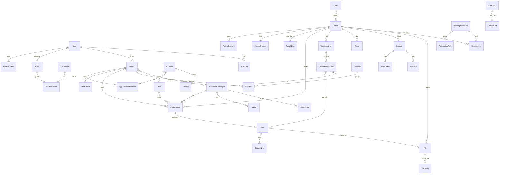

# Database Design (PostgreSQL 17 on Neon + Sequelize)

## Conventions

- UUID v4 primary keys, `created_at` / `updated_at` everywhere (append-only tables have `created_at` only).
- **Paranoid (soft delete, `deleted_at`)** on clinical and patient records: Patient, MedicalHistory, Visit, ClinicalNote, TreatmentPlan(+Step), File, Invoice, Payment, Appointment.
- **App-level encryption** (AES-256-GCM, key from env/KMS, key-version column) for `MedicalHistory.data`, `ClinicalNote.body`, `Patient.allergies`, and `Patient.notes`. A `phone_hash` (HMAC) allows lookups without decrypting where needed. Phone itself stays plaintext-indexed because front-desk search needs it; this is a documented trade-off.
- Money is stored as integer paise (`amount_paise BIGINT`), with currency `INR`.
- Times are stored as `timestamptz` (UTC). The clinic timezone `Asia/Kolkata` lives in Settings.
- Migrations only (TypeScript + umzug, registered in `backend/src/db/migrator.ts`). There is never a `sync()`. Seeders: `required` (permissions, roles, branches, settings; idempotent) and `demo` (clearly fake: "Demo Patient 01", `@expressions.test` staff, +44 7700 900xxx fiction-range phones; refuses to run in production).

## Implementation status

Tables are created by the phase that first uses them, so business decisions still open (booking model B1, OTP channel B2) don't force a rewrite of tables built speculatively.

| Phase | Tables                                                                                                                                                                        |
| ----- | ----------------------------------------------------------------------------------------------------------------------------------------------------------------------------- |
| 1 ✅  | `roles`, `permissions`, `role_permissions`, `users`, `refresh_tokens`, `audit_logs`, `rate_limits`, `settings`, `locations`, `patients`, `patient_consents`, `otp_challenges` |
| 3     | `doctors`, `treatment_catalogue`, `blog_posts`, `categories`, `faqs`, `testimonials`, `gallery_items`, `page_seo`                                                             |
| 4     | `appointments`, `appointment_slot_rules`, `holidays`, `staff_leaves`, `chairs`, `waitlist_entries`, `leads`                                                                   |
| 5     | `medical_histories`, `family_links`, `visits`, `clinical_notes`, `treatment_plans`(+steps), `recalls`, `files`, `file_shares`, `invoices`(+items), `payments`                 |
| 6     | `message_templates`, `message_logs`, `automation_rules`                                                                                                                       |

Phase-1 deviations from the model list below: patient login is keyed by **phone**, not patient id (`refresh_tokens.subject_id` holds the E.164 number for patients), because Indian families commonly share one number. Throttling uses a `rate_limits` table instead of Redis.

## ERD

## Models (fields abbreviated)

| Model                                  | Key fields                                                                                                                                                                                                                                                                        | Indexes / notes                                                                                 |
| -------------------------------------- | --------------------------------------------------------------------------------------------------------------------------------------------------------------------------------------------------------------------------------------------------------------------------------- | ----------------------------------------------------------------------------------------------- |
| **User**                               | email, phone, password_hash (argon2id), role_id, status, totp_secret_enc, totp_enabled, last_login_at                                                                                                                                                                             | unique(email)                                                                                   |
| **Role / Permission / RolePermission** | key (`appointments.read`, `patients.clinical.write`…), description                                                                                                                                                                                                                | seeded: super_admin, doctor, receptionist, assistant                                            |
| **RefreshToken**                       | user_id / patient_id, token_hash, family_id, expires_at, revoked_at, ip, ua                                                                                                                                                                                                       | rotation + reuse detection                                                                      |
| **Location**                           | name, slug, address fields, geo, phone, place_id, hours JSON, timezone                                                                                                                                                                                                            | Mapusa (+ Candolim if confirmed)                                                                |
| **Chair**                              | location_id, name, active                                                                                                                                                                                                                                                         |                                                                                                 |
| **Doctor**                             | user_id?, slug, name, qualifications, registration_no, specialisations[], bio, photo, experience_years, published, color                                                                                                                                                          | unique(slug)                                                                                    |
| **AppointmentSlotRule**                | doctor_id, location_id, weekday, start, end, break_start/end, slot_minutes, effective_from/to                                                                                                                                                                                     |                                                                                                 |
| **Holiday / StaffLeave**               | date range, location or doctor, reason                                                                                                                                                                                                                                            |                                                                                                 |
| **TreatmentCatalogue**                 | slug, name, category, short/long content (CMS), default_duration_min, sittings_typical, price_min/max_paise, show_price, recall_after_days, status, review_status                                                                                                                 | unique(slug)                                                                                    |
| **Patient**                            | code (EDC-000123), name, phone, phone_hash, email, dob, gender, address, source, tags[], allergies_enc, notes_enc, preferred_language                                                                                                                                             | idx(phone), idx(name trigram)                                                                   |
| **PatientConsent**                     | patient_id, type (`whatsapp_transactional`, `whatsapp_marketing`, `sms`, `email`, `data_processing`, `photo_use`), granted, channel, ip, text_version, timestamp, withdrawn_at                                                                                                    | append-only                                                                                     |
| **MedicalHistory**                     | patient_id, data_enc (conditions, medications, pregnancy, etc.), reviewed_at                                                                                                                                                                                                      | 1:1                                                                                             |
| **FamilyLink**                         | guardian_patient_id, dependant_patient_id, relation                                                                                                                                                                                                                               |                                                                                                 |
| **Appointment**                        | patient_id, doctor_id, chair_id, location_id, treatment_id, plan_step_id?, start_at, end_at, status (`booked → confirmed → checked_in → in_chair → completed / no_show / cancelled`), source (`web`, `phone`, `walk_in`, `whatsapp`, `admin`), notes, cancelled_reason, booked_by | idx(doctor_id, start_at), idx(start_at), exclusion constraint against overlaps per doctor/chair |
| **WaitlistEntry**                      | patient_id, treatment_id, preferred window                                                                                                                                                                                                                                        |                                                                                                 |
| **Visit**                              | appointment_id?, patient_id, doctor_id, date, chief_complaint, treatments_done[], summary                                                                                                                                                                                         | idx(patient_id, date)                                                                           |
| **ClinicalNote**                       | visit_id, author_id, body_enc, tooth_numbers[] (FDI)                                                                                                                                                                                                                              |                                                                                                 |
| **TreatmentPlan / TreatmentPlanStep**  | title, status, estimate_paise / sequence, title, treatment_id, status, planned_date, visit_id                                                                                                                                                                                     |                                                                                                 |
| **Recall**                             | patient_id, type (`6m_checkup`, `post_op`, `next_sitting`), due_date, status, last_notified_at                                                                                                                                                                                    | idx(due_date, status)                                                                           |
| **File**                               | patient_id, visit_id?, kind (`xray`, `opg`, `rx`, `report`, `invoice`, `photo`), storage_key, mime, size, sha256, uploaded_by                                                                                                                                                     | storage is private only                                                                         |
| **FileShare**                          | file_id, channel, token_hash, expires_at, accessed_at                                                                                                                                                                                                                             | signed, expiring                                                                                |
| **Invoice / InvoiceItem / Payment**    | number (per FY), status, totals, GST fields / desc, qty, unit_paise / mode (`cash`, `upi`, `card`, `razorpay`), amount, ref                                                                                                                                                       |                                                                                                 |
| **Lead**                               | name, phone, source (`web_form`, `symptom_helper`, `whatsapp_click`, `call_click`), payload, utm, status (`new → contacted → booked / lost`), assigned_to, patient_id?                                                                                                            |                                                                                                 |
| **MessageTemplate**                    | key, provider_template_name, language, category (`utility`/`marketing`), body, variables[], approval_status                                                                                                                                                                       |                                                                                                 |
| **MessageLog**                         | patient_id, template_id, channel, provider_msg_id, status (`queued`, `sent`, `delivered`, `read`, `failed`), error, cost                                                                                                                                                          | idx(provider_msg_id)                                                                            |
| **AutomationRule**                     | trigger, conditions JSON, template_id, channel, delay, quiet_hours_respect, active                                                                                                                                                                                                |                                                                                                 |
| **BlogPost / Category**                | slug, title, excerpt, body (MDX/blocks), author_doctor_id, reviewer_doctor_id, reviewed_at, references[], status (`draft`, `needs_doctor_review`, `published`), published_at                                                                                                      |                                                                                                 |
| **Testimonial**                        | quote, name, location, source, source_url, rating?, consent_on_file, date                                                                                                                                                                                                         |                                                                                                 |
| **GalleryItem**                        | before/after/single images, treatment_id, caption, alt, consent_file_id                                                                                                                                                                                                           | consent is required to publish before/after                                                     |
| **FAQ**                                | question, answer, treatment_id?, order, review_status                                                                                                                                                                                                                             |                                                                                                 |
| **PageSEO**                            | route, title, description, og_image, canonical, noindex                                                                                                                                                                                                                           |                                                                                                 |
| **Setting**                            | key, value JSON (clinic info, quiet hours, branding)                                                                                                                                                                                                                              |                                                                                                 |
| **AuditLog**                           | actor_type, actor_id, action, entity, entity_id, diff (PHI redacted), ip, ua, at                                                                                                                                                                                                  | append-only, partitioned by month                                                               |

Additions beyond the brief's minimum list are **Location, Chair, StaffLeave, WaitlistEntry, InvoiceItem and FileShare**. These are needed for two branches, chair-level calendars, waiting lists and secure sharing.
